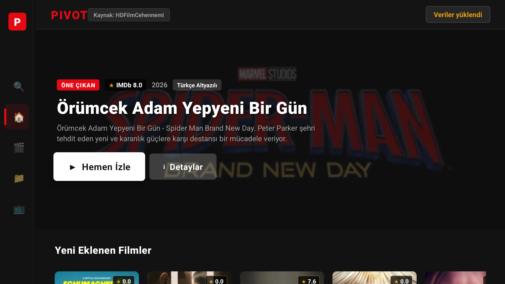

# 🛋️ PIVOT (Android TV & TV Box)

> *"PIVOT! PIVOT! PIIIVVOOOTTT!!" — Ross Geller*  
> Koltuğunuzdan kalkmadan, uzaktan kumandanızla film ve diziler arasında akıcı ve keyifli geçiş yapabileceğiniz modern Android TV medya uygulaması.

---

<p align="center">
  
</p>

---

## 📥 İndir & Hazır Sürümler (Pre-built APKs)

Uygulamayı herhangi bir derleme yapmadan doğrudan Android TV veya TV Box cihazınızda denemek için hazır derlenmiş bağımsız (standalone) APK dosyalarını kullanabilirsiniz:

- ⬇️ **[MovieTvApp-v2-release.apk (v2.0 Güncel Sürüm)](build/MovieTvApp-v2-release.apk)**  
  *(Önerilen Sürüm — Yeni Android TV Leanback logosu ve banner'ı, Android TV yerel sistem klavyesi (Gboard) ve mikrofonla sesli arama desteği, anasayfa sabit satır başlı yatay kaydırma, 5 kolonlu simetrik film/dizi kataloğu ve TV D-pad kilit korumaları.)*
- ⬇️ **[MovieTvApp-release.apk (v1.0 Beta)](build/MovieTvApp-release.apk)**  
  *(İlk Bağımsız Beta Sürümü — Temel D-pad navigasyon ve ExoPlayer oynatıcı prototipi.)*

---

## 🚀 Özellikler

- **%100 Uzaktan Kumanda (D-Pad) Navigasyonu:** Dokunmatik ekran gerektirmez; standart Android TV ve Bluetooth kumandalarla (Yukarı, Aşağı, Sol, Sağ, OK, Geri) kusursuz odak yönetimi.
- **Modern TV Arayüzü:**
  - Saf koyu tema (`#121212` / `#0F0F0F`).
  - Açılışta profil seçimi olmadan doğrudan zengin içerik ekranı.
  - Öne çıkan içerik afişi (Billboard Hero Banner).
  - 3 kolonlu (`numColumns={3}`) ferah kategori ızgarası ve otomatik ekran merkezleme (`scrollToOffset`).
- **Native ExoPlayer Video Oynatıcı:**
  - **16:9 Tam Ekran Modu:** `SurfaceView` donanım katmanını piksel bazında dinamik boyutlandırarak sinemaskop siyah barları tamamen yok eden `cover` modu.
  - **Yerel Altyazı Motoru (Native Subtitle Engine):** WebVTT ayrıştırıcı, saydam arka plan, 24px yüksek kontrastlı gölgelendirme ve otomatik Türkçe altyazı önceliği.
  - **Akıllı Hızlı Sarma (Debounced Seek):** Kumandadan hızlı tıklamalarda ses çökmesini engelleyen 350ms tampon korumalı sarma HUD göstergesi.
  - **IPTV Yan Çekmece Menüsü:** Video oynatılırken ses kanalı, altyazı, en-boy oranı ve video kaynağı değiştirme menüsü.
- **2GB RAM Bellek Optimizasyonu:**
  - Düşük donanımlı TV kutuları (Next Start 4K, Xiaomi Mi Box, vb.) için `backBufferDurationMs: 0` ile `BufferPool2.0` RAM şişmesi ve ses cızırtısı tamamen önlenmiştir.
- **Çoklu Kaynak Mimarisi (Multi-Source Provider Pattern):**
  - Arayüz ile veri çekme motoru birbirinden tamamen bağımsızdır (`IMovieSourceProvider` mimarisi).

---

## 🛠️ Teknolojiler

- **Framework:** [React Native TVOS](https://github.com/react-native-tvos/react-native-tvos) (v0.83)
- **Dil:** TypeScript
- **Video Çözücü:** `react-native-video` (ExoPlayer / Android Media3)
- **Ayrıştırma (Parser):** `cheerio`
- **Hedef Cihazlar:** Android TV 7.0+ (API 24 - API 36), Next Start 4K, Xiaomi Mi Box / Stick, Google TV, AOSP TV Box'lar.

---

## 📦 Kurulum ve Çalıştırma

### Gereksinimler
- Node.js (v18+)
- Android SDK (API 34 veya 36)
- Java 17

### 1. Bağımlılıkları Yükleyin
```bash
npm install
```

### 2. JS Paketini Derleyin
```bash
npx react-native bundle --platform android --dev false --entry-file index.js --bundle-output android/app/src/main/assets/index.android.bundle --assets-dest android/app/src/main/res
```

### 3. Debug APK Derleyin
```bash
cd android
./gradlew assembleDebug
```

Derlenen APK: `android/app/build/outputs/apk/debug/app-debug.apk` yolunda oluşturulacaktır.

### 4. TV Kutusuna veya Emülatöre Yükleyin
```bash
adb install -r android/app/build/outputs/apk/debug/app-debug.apk
```

---

## 📄 Lisans (License)

Bu proje **GNU General Public License v3.0 (GPL-3.0)** altında lisanslanmıştır.

- Bu yazılımın kaynak kodları herkese açıktır.
- Kodlar ticari amaçla satılamaz, ücretli dağıtılamaz veya kapalı devre bir ürün haline getirilemez.
- Kod üzerinde yapılan herhangi bir değişiklik ve geliştirme yine GPL-3.0 lisansı ile açık kaynak olarak paylaşılmak zorundadır.

---

## ⚖️ Yasal Uyarı (Disclaimer)

Bu uygulama yalnızca **eğitim ve hobi** amaçlı geliştirilmiş bir medya oynatıcı istemcisidir. Uygulama kendi sunucularında hiçbir video veya telifli medya dosyası barındırmaz; yalnızca internette herkese açık olarak sağlanan kaynakları ayrıştırır. Tüm telif hakları ilgili hak sahiplerine aittir.
